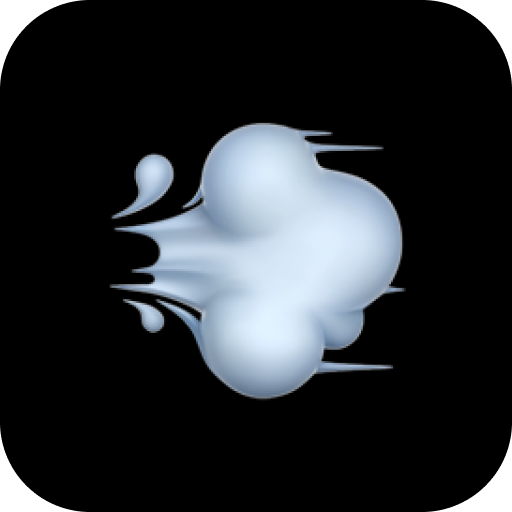

# aire

<p align="center">
  
</p>

A lightweight, elegant floating window mirror that stays on top while you work.

## Features

- **Window Mirroring**: Stream any desktop window into a floating picture-in-picture view.
- **Hover Transparency**: See through the window on hover with smooth opacity transitions.
- **Minimal Pure Black UI**: Seamless draggable controls with circular buttons.
- **Window Management**: Grab anywhere to move, resize from any edge or corner, and Alt-Tab integration.
- **System Tray**: Minimizes to tray, spawn multiple mirrors, pause streams, and configure preferences.

## Build from Source

### Prerequisites

- Rust (1.80+)
- Linux: `pipewire-devel`, `libxkbcommon-devel`, `vulkan-loader-devel`, `clang`

### Build & Run

```bash
cargo build --release
./target/release/aire
```

## Platform Support

- **Linux (Wayland)**: PipeWire + XDG Desktop Portal.
- **macOS**: ScreenCaptureKit seam.
- **Windows**: Windows.Graphics.Capture seam.
